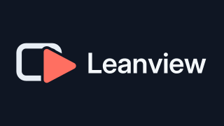

# LeanView

[Español](#español) | [English](#english)

---

## Español

LeanView es un reproductor de YouTube para Android TV, Google TV y teléfonos Android. Sin anuncios en el reproductor y sin necesidad de iniciar sesión: abres la aplicación y buscas o miras vídeos. Si quieres, puedes iniciar sesión con tu cuenta de Google para ver tus suscripciones y tu historial.

LeanView no recoge datos de ningún tipo. Qué conexiones hace la aplicación, a quién y por qué, está en [PRIVACY.md](PRIVACY.md).

### Descargar

Los archivos de instalación (APK) están en la página de versiones: <https://github.com/leanview/leanview/releases/latest>

En cada versión hay tres archivos `Leanview_<versión>_<tipo>.apk`:

| Archivo | Cuándo usarlo |
|---|---|
| `armeabi-v7a` | La mayoría de televisores y cajas con Google TV o Android TV, y los equipos más antiguos. |
| `arm64-v8a` | Teléfonos y televisores recientes de 64 bits. |
| `universal` | Si no sabes cuál elegir: funciona en todos, pero pesa más. |

### Instalar en un televisor (Google TV o Android TV)

1. En el televisor, abre la tienda de aplicaciones e instala la aplicación **Downloader** (de AFTVnews).
2. Abre Downloader. La primera vez pide permiso para acceder a archivos: acéptalo. En los ajustes de Downloader, activa **Enable JavaScript** si la página de GitHub no muestra la lista de archivos.
3. En la barra de dirección de Downloader escribe `github.com/leanview/leanview/releases/latest` y confirma. Se abre la página de la última versión.
4. Baja hasta **Assets**, elige el archivo `.apk` que corresponda a tu televisor (si dudas, el `universal`) y descárgalo.
5. Cuando termine, pulsa **Instalar**. Si Android dice que Downloader no puede instalar aplicaciones desconocidas, pulsa **Ajustes**, activa **Permitir desde esta fuente** y vuelve atrás.
6. Pulsa **Instalar** y después **Abrir**. Cuando Downloader pregunte si quieres borrar el archivo, puedes decir que sí.

Si prefieres no usar Downloader, descarga el APK en tu teléfono o en un ordenador, cópialo a una memoria USB o envíalo al televisor con una aplicación de transferencia de archivos, y ábrelo con un explorador de archivos del televisor. En Android TV 8 o anterior la opción se llama **Ajustes > Seguridad y restricciones > Orígenes desconocidos**.

### Instalar en un teléfono Android

1. En el teléfono abre <https://github.com/leanview/leanview/releases/latest> con tu navegador.
2. Descarga el `.apk` (`arm64-v8a` en casi todos los teléfonos actuales; si dudas, `universal`).
3. Ábrelo desde las descargas. Android pedirá permiso para que el navegador instale aplicaciones. Ese permiso se queda concedido a ese navegador hasta que lo quites: puedes revocarlo en **Ajustes > Aplicaciones > (tu navegador) > Instalar apps desconocidas**.
4. Pulsa **Instalar**. Google Play Protect puede avisar de que la aplicación no viene de Play Store: es normal, porque LeanView no se distribuye ahí.

En el teléfono, la misma aplicación se maneja con el dedo. Si en algún aparato la pantalla no se adapta bien, cambia **Ajustes > Interfaz de usuario > Tipo de pantalla** (Automático, TV o Teléfono).

### Comprobar que la descarga es auténtica

Los APK de LeanView están firmados con un certificado propio cuya huella SHA-256 es:

`7cdbbb0d922f07c998fc3297c40c78bbab829e731c6eec91633b8a839838c075`

Con las herramientas de Android SDK puedes comprobarlo: `apksigner verify --print-certs Leanview_<versión>_universal.apk`. Si la huella no coincide, no instales el archivo.

### Actualizaciones

Al abrirse, LeanView comprueba en `github.com/leanview/leanview` si hay una versión nueva. Si la hay, **descarga el APK en segundo plano** desde esa misma página de versiones y después te avisa y te pide confirmar la instalación (Android te lo vuelve a preguntar). Puedes desactivar la comprobación en **Ajustes > Acerca de**. Allí mismo, **Versiones** abre la página de descargas y **Licencias** muestra la licencia y los avisos.

### Código fuente

LeanView es software libre bajo la licencia GPL-3.0. El código fuente de cada versión está en este repositorio: la confirmación (commit) con la etiqueta de la versión, por ejemplo `v1.0.0`, contiene exactamente el código con el que se construyeron los APK de esa versión, y `README_BUILD.md` explica cómo construirlos.

### Problemas y sugerencias

Abre una incidencia en <https://github.com/leanview/leanview/issues>. Indica la versión (Ajustes > Acerca de), el aparato y qué pasó. No pongas contraseñas, códigos de inicio de sesión ni direcciones privadas. Los fallos de seguridad se comunican como se explica en [SECURITY.md](SECURITY.md).

### Aviso legal y licencia

LeanView es un proyecto independiente. No está afiliado, respaldado ni conectado de ningún modo con YouTube, con Google ni con el proyecto SmartTube. YouTube es una marca registrada de Google LLC; los demás nombres son marcas de sus propietarios. LeanView se ofrece sin garantía de ningún tipo; el uso de YouTube a través de ella está sujeto a las condiciones del servicio de YouTube.

LeanView se basa en [SmartTube](https://github.com/yuliskov/SmartTube) (licencia MIT; su aviso de licencia se conserva tal cual en [NOTICE.md](NOTICE.md)) y contiene código GPL-3.0 derivado de [NewPipe](https://github.com/TeamNewPipe/NewPipe) y de [bgutil-ytdlp-pot-provider](https://github.com/Brainicism/bgutil-ytdlp-pot-provider). Por eso LeanView se distribuye bajo la GPL-3.0: véase [LICENSE](LICENSE). Los demás componentes y sus licencias están en [THIRD_PARTY_NOTICES.md](THIRD_PARTY_NOTICES.md).

---

## English

LeanView is a YouTube player for Android TV, Google TV and Android phones. No ads in the player and no account needed: open the app and search or watch. If you want, you can sign in with your Google account to see your subscriptions and history.

LeanView collects no data of any kind. What connections the app makes, to whom and why, is in [PRIVACY.md](PRIVACY.md).

### Download

The installation files (APKs) are on the releases page: <https://github.com/leanview/leanview/releases/latest>

Each release has three files named `Leanview_<version>_<type>.apk`:

| File | When to use it |
|---|---|
| `armeabi-v7a` | Most TVs and boxes running Google TV or Android TV, and older devices. |
| `arm64-v8a` | Recent 64-bit phones and TVs. |
| `universal` | If you do not know which one to pick: it works everywhere, but it is larger. |

### Install on a TV (Google TV or Android TV)

1. On the TV, open the app store and install the **Downloader** app (by AFTVnews).
2. Open Downloader. The first time it asks for permission to access files: accept. In Downloader's settings, turn on **Enable JavaScript** if the GitHub page does not show the list of files.
3. In Downloader's address bar type `github.com/leanview/leanview/releases/latest` and confirm. The page of the latest release opens.
4. Scroll down to **Assets**, choose the `.apk` that matches your TV (the `universal` one if unsure) and download it.
5. When it finishes, press **Install**. If Android says Downloader cannot install unknown apps, press **Settings**, turn on **Allow from this source** and go back.
6. Press **Install** and then **Open**. When Downloader asks whether to delete the file, you can say yes.

If you prefer not to use Downloader, download the APK on a phone or a computer, copy it to a USB stick or send it to the TV with a file-transfer app, and open it with a file manager on the TV. On Android TV 8 or older the setting is **Settings > Security & restrictions > Unknown sources**.

### Install on an Android phone

1. On the phone, open <https://github.com/leanview/leanview/releases/latest> in your browser.
2. Download the `.apk` (`arm64-v8a` on almost all current phones; `universal` if unsure).
3. Open it from your downloads. Android asks for permission for the browser to install apps. That permission stays granted to that browser until you remove it: you can revoke it in **Settings > Apps > (your browser) > Install unknown apps**.
4. Tap **Install**. Google Play Protect may warn that the app does not come from the Play Store: that is expected, because LeanView is not distributed there.

On a phone the same app is used with your finger. If the screen does not adapt on some device, change **Settings > User interface > Screen type** (Automatic, TV or Phone).

### Check that the download is genuine

LeanView APKs are signed with a certificate of their own whose SHA-256 fingerprint is:

`7cdbbb0d922f07c998fc3297c40c78bbab829e731c6eec91633b8a839838c075`

With the Android SDK tools you can check it: `apksigner verify --print-certs Leanview_<version>_universal.apk`. If the fingerprint does not match, do not install the file.

### Updates

When it opens, LeanView checks `github.com/leanview/leanview` for a newer version. If there is one, it **downloads the APK in the background** from that same releases page, then tells you and asks you to confirm the install (Android asks you again). You can turn the check off in **Settings > About**. In the same place, **Releases** opens the download page and **Licenses** shows the license and the notices.

### Source code

LeanView is free software under the GPL-3.0 license. The source code of each release is in this repository: the commit tagged with the version, for example `v1.0.0`, holds exactly the source the APKs of that version were built from, and `README_BUILD.md` explains how to build them.

### Problems and suggestions

Open an issue at <https://github.com/leanview/leanview/issues>. Say which version (Settings > About), which device and what happened. Do not post passwords, sign-in codes or private addresses. Security problems are reported as described in [SECURITY.md](SECURITY.md).

### Disclaimer and license

LeanView is an independent project. It is not affiliated with, endorsed by or connected to YouTube, Google or the SmartTube project in any way. YouTube is a trademark of Google LLC; all other names are trademarks of their owners. LeanView is provided without warranty of any kind; using YouTube through it is subject to YouTube's terms of service.

LeanView is based on [SmartTube](https://github.com/yuliskov/SmartTube) (MIT license; its license notice is kept verbatim in [NOTICE.md](NOTICE.md)) and contains GPL-3.0 code derived from [NewPipe](https://github.com/TeamNewPipe/NewPipe) and [bgutil-ytdlp-pot-provider](https://github.com/Brainicism/bgutil-ytdlp-pot-provider). That is why LeanView as a whole is distributed under the GPL-3.0: see [LICENSE](LICENSE). The other components and their licenses are in [THIRD_PARTY_NOTICES.md](THIRD_PARTY_NOTICES.md).
